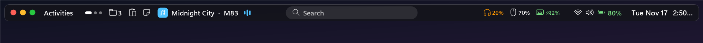
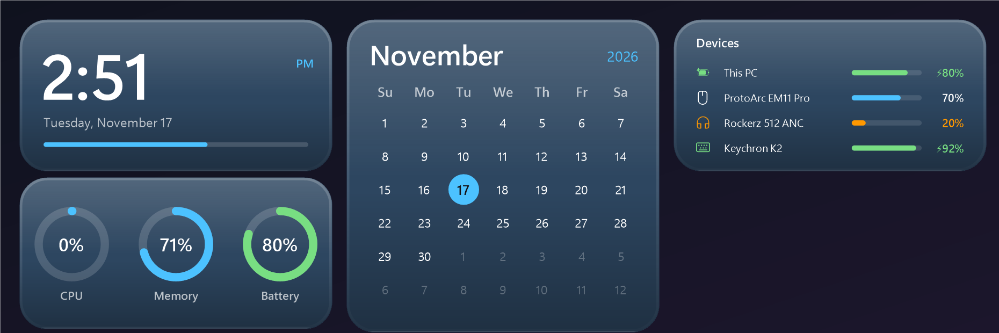
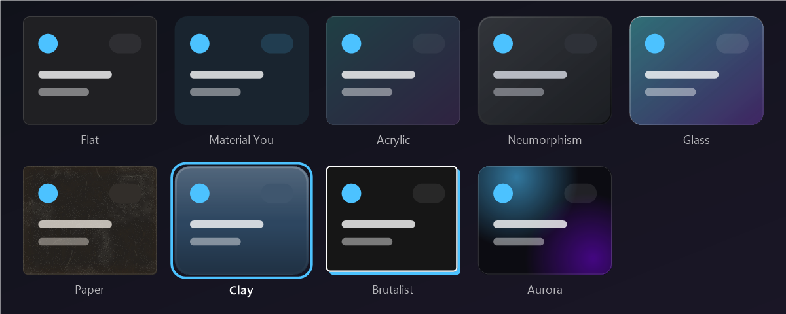
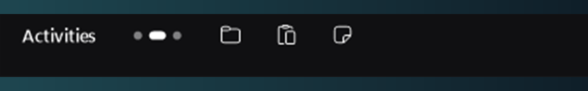
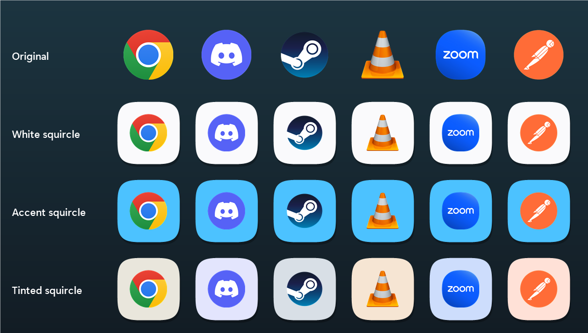

<div align="center">

# Upbar

**A fast, zero-dependency desktop top bar, quick settings control center, and widget suite for Windows 10 & 11.**  
Built with the in-box Windows C# compiler (~430 KB executable, 0 external packages, 240 Hz spring animations).

[](https://github.com/BibekPoudel38/upbar)
[-2ea44f?style=flat-square)](https://github.com/BibekPoudel38/upbar)
[](LICENSE)

</div>



---

## Highlights

- **Zero-Install Build:** Compiles in under 2 seconds using `build.bat` and the `csc.exe` compiler already built into every Windows installation—no Visual Studio, NuGet, or SDK downloads required.
- **240 Hz Spring Physics & SWAR Alpha Compositing:** Liquid sliding hover capsules, elastic pill transitions, and per-pixel alpha fades synced to your monitor's refresh rate via `DwmFlush`.
- **Connected Peripherals & Deep Battery Telemetry:**
  - Displays connected headphones, mice, keyboards, phones, game controllers, and removable USB drives right on the bar.
  - Inline **color-coded battery percentages** beside each device icon (**green** `⚡` while charging, **orange** below 30%, **red** below 20%).
  - Reads battery levels across Classic Bluetooth (`DEVPKEY_Bluetooth_Battery`), Bluetooth LE GATT (`0x180F`), and **Compx/Beken `0xFF02` 17-byte vendor HID telemetry** (supporting wireless mice like the **ProtoArc EM11 Pro** that omit standard GATT battery services).
- **Android Phone Integration (ADB / `scrcpy`):**
  - Shows live phone battery and cellular signal bars on the top bar.
  - View and open phone notifications, mirror the screen in one click, drag-and-drop files straight to `/sdcard/Download/`, or launch **Android 16+ Desktop Mode** on a virtual PC-sized secondary display.
- **Built-in GitHub Self-Updater:** Check for new releases and update `Upbar.exe` in place with a single click from **Settings → System**.

---

## Desktop Widgets



Upbar includes **8 snap-to-grid desktop widgets** pinned cleanly behind your windows (`Progman`-owned so `Win+D` / Show Desktop never hides them). Right-click any widget to switch its visual style, grid size (`1×1`, `1×2`, `2×2`, `2×4`, `4×4`), or lock position:

1. **Clock** — 8 faces (*Digital*, *Analog*, *Stacked*, *Slim*, *Tall*, *Minimal*, *Spoken Words*, and *Orbit*).
2. **Weather** — Current conditions and 3-day forecast powered by Open-Meteo (no API key needed) with Fluent 3D weather art.
3. **Calendar** — Monthly view with an animated accent indicator for today.
4. **System** — Live CPU, memory, and battery usage rings.
5. **App Grid** — 12-slot launcher (`apps.txt`) with drag-and-drop shortcut support and auto-generated **App Colour** or **Material You** squircle icons.
6. **Devices** — Real-time battery bars and charging indicators for your PC and connected Bluetooth/BLE peripherals.
7. **Now Playing** — Album cover art, track metadata, and media transport controls via Windows `SMTC`.
8. **Notes** — Live preview of your latest Markdown note; click to open the full split-pane Markdown editor (`Alt+N`).

---

## 9 Visual Styles & Customizations



Switch the entire bar, popups, and desktop widgets live between 9 distinct materials:
**Flat** · **Material You** · **Acrylic** · **Neumorphism** · **Glass** · **Paper** · **Clay** · **Brutalist** · **Aurora**

### Workspace Dots & Squircle Icons

| GNOME-Style Workspace Dots | Tinted Squircle Shortcut Icons |
| :---: | :---: |
|  |  |

- **Traffic Lights & Dynamic Bar Tinting:** Optional macOS-style window controls (`Close`, `Minimize`, `Restore`) when a window is maximized, plus automatic bar color matching (`SampleApp`) that samples the active window's title bar.
- **Hardware Cursor Themes:** Generate and apply Windows hardware cursor themes (*Accent*, *Minimal*, *Neon*) at 0% CPU cost, with automatic backup and restore.
- **Tinted Squircles:** One-click Samsung/One UI-style pastel squircle icon generator for Desktop and Start Menu shortcuts (with full original icon backup & restore).

---

## Quick Settings Control Center & Smart Pills

- **Control Center:** Resizable `1×1`, `1×2`, and `2×2` tiles for **Wi-Fi** (with inline network scanner and password entry), **Bluetooth** (Classic + BLE device list with battery readings), **Sound Output** (device switcher + per-app volume mixer), **Microphone**, **Camera & Location Privacy**, **Dark Theme**, **Power Mode**, **Flight Mode**, **Mobile Hotspot**, **Live dB Sound Meter** (with hearing-safety threshold alerts), **Keyboard Layout**, **Screen Cast**, and **Hidden Tray Icons**.
- **Smart Activity Chip:** Automatically surfaces the most relevant live activity:
  - Active browser downloads with live MB progress (`Downloads` folder watcher)
  - Windows Clock app running timers and upcoming alarms
  - Upcoming calendar meetings within 15 minutes with one-click **Join** (`Teams` / `Zoom` / `Meet`)
  - Copied URLs (`Open link`), screen recorder alerts (`OBS` / `ffmpeg`), and low-battery warnings
- **File Shelf & Clipboard History:** Drag files onto the bar to hold them in the **File Shelf**, or open **Clipboard History** (synced with Windows `Win+V` plus pinned snippets).
- **Markdown Notes (`Alt+N`):** Fast Markdown notebook with live rendered preview, checklists, code blocks, auto-formatted tables, and image pasting.

---

## Building & Running

No external tools or SDKs are required—Windows 10 and 11 include everything needed.

```bat
git clone https://github.com/BibekPoudel38/upbar.git
cd upbar
build.bat
Upbar.exe
```

### Command-Line Flags

| Command | Description |
| :--- | :--- |
| `Upbar.exe` | Launches the top bar and desktop widgets (single-instance mutex). |
| `Upbar.exe --selftest` | Runs the built-in unit test suite and exits with `0` on success. |
| `Upbar.exe --squircles` | Applies tinted squircle icons to Desktop & Start Menu shortcuts. |
| `Upbar.exe --squircles-undo` | Restores all shortcuts to their original icons. |
| `Upbar.exe --make-icon upbar.ico` | Regenerates the application `.ico` file from vector art. |

---

## How "Check for Updates" Works

Upbar includes a built-in self-updater in **Settings → System → Check for updates**:

1. **Checking:** Queries the GitHub Releases API (`https://api.github.com/repos/BibekPoudel38/upbar/releases/latest`) and compares the latest semantic tag (`vX.Y.Z`) against the running `Updater.Version`.
2. **Publishing a Release:** Pushing any version tag (`git tag v1.1.0 && git push origin v1.1.0`) triggers the included [GitHub Actions workflow](.github/workflows/release.yml), which compiles `Upbar.exe`, runs `Upbar.exe --selftest`, and attaches `Upbar.exe` + `Upbar-win64.zip` to the GitHub Release.
3. **One-Click In-Place Upgrade:** When an update is available, clicking the update row downloads the new `Upbar.exe`, renames the currently running binary to `Upbar.exe.old`, swaps the new binary into place, and restarts Upbar automatically (cleaning up `Upbar.exe.old` on startup).

---

## Project Structure

```text
upbar/
├── src/
│   ├── TopBar.cs          # AppBar docking, 240Hz spring layout, pills, drag & drop, self-tests
│   ├── ControlCenter.cs   # Quick settings panel, sliders, resizable tile grid, detail views
│   ├── DesktopWidgets.cs  # 8 desktop widgets (Clock, Weather, Calendar, System, Apps, Devices, Media, Notes)
│   ├── Activity.cs        # Calendar meetings, Clock timers, Downloads, ADB/scrcpy phone & BLE/HID battery
│   ├── Sys.cs             # WinRT Wi-Fi scan/connect, Classic+BLE Bluetooth, Toast listener, WMI brightness
│   ├── Audio.cs           # CoreAudio master volume, endpoint switching, and per-app session mixer
│   ├── Media.cs           # Windows SMTC media session listener & MediaPopup.cs player
│   ├── Notes.cs           # Split-pane Markdown editor & renderer (Alt+N)
│   ├── SearchPopup.cs     # Web/AI launcher, inline expression calculator, and unit converter
│   ├── Icons.cs           # Squircle shortcut icon generator & hardware Windows cursor themes
│   ├── Widgets.cs         # 9 visual styles, glass/acrylic/clay renderer, and UI controls
│   ├── SettingsWindow.cs  # Windows 11-style settings window
│   ├── Backup.cs          # Zip backup/restore and GitHub Releases self-updater (Updater)
│   └── Native.cs          # Win32/DWM interop, SWAR alpha blitter, Vsync loop, and Fluent glyphs
├── fonts/                 # Bundled Montserrat font family
├── weather/               # Bundled Fluent 3D weather icons
├── assets/                # README screenshots
└── build.bat              # Zero-dependency build script using in-box .NET Framework 4 csc.exe
```

## License

Released under the [MIT License](LICENSE).
